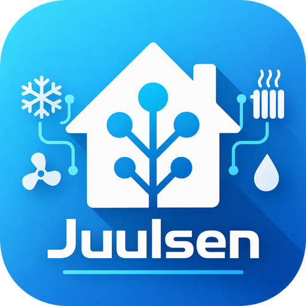
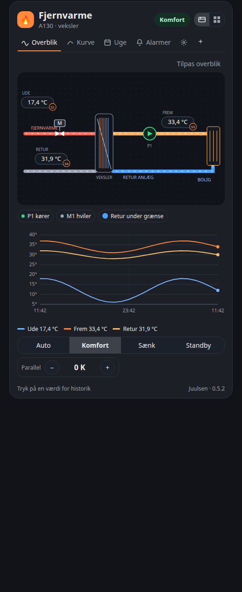
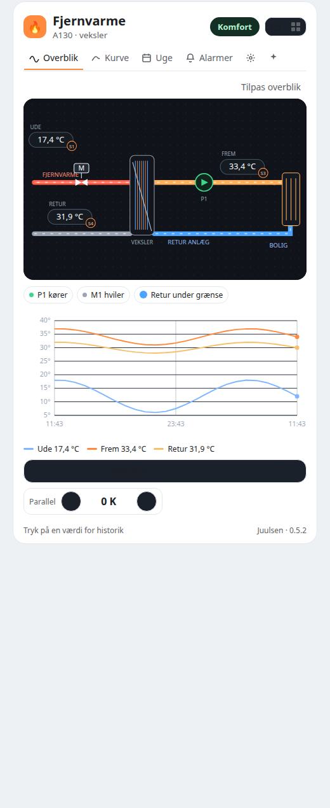
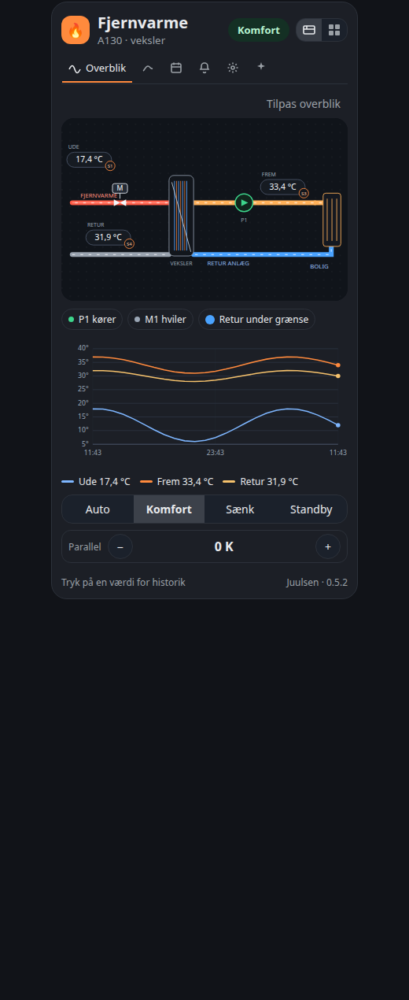
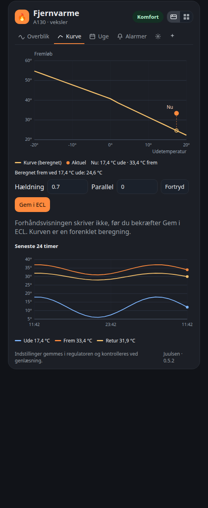
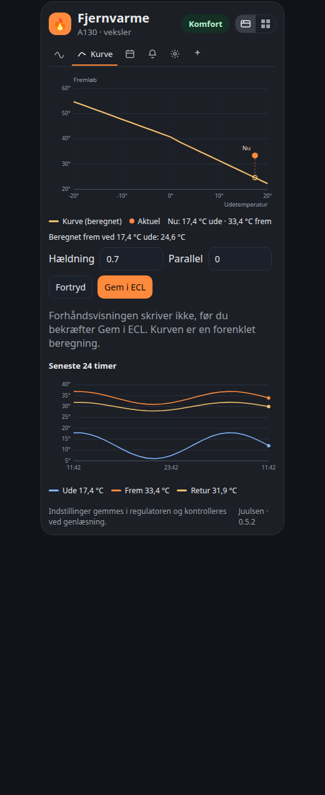
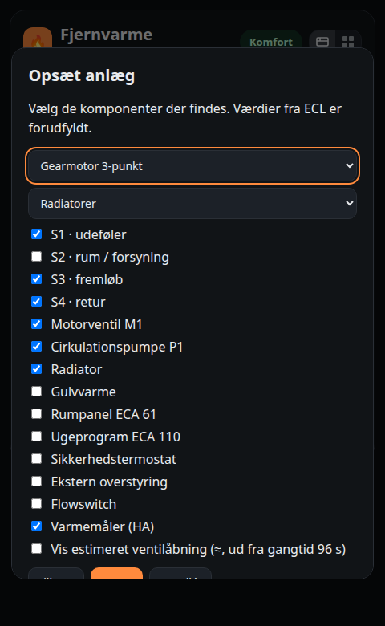
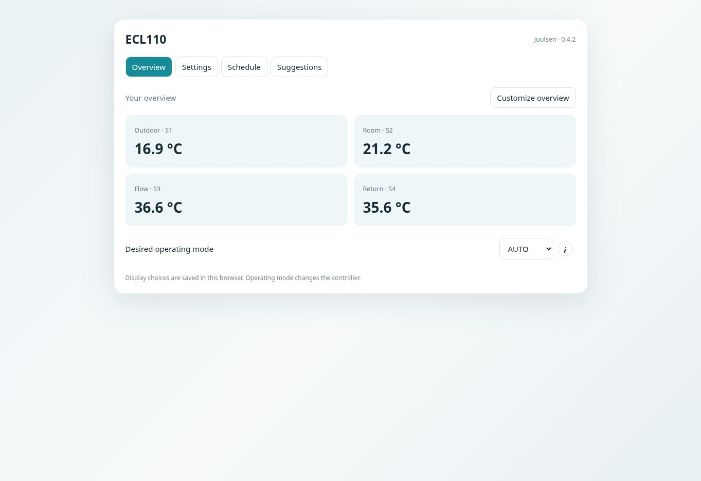
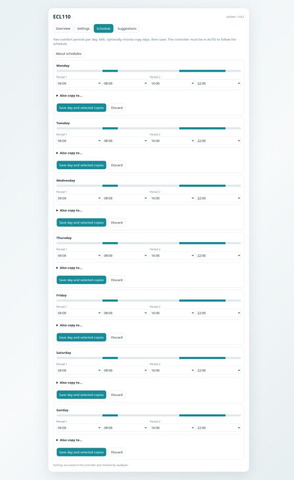

<p align="center">
  
</p>

# Danfoss ECL110 Modbus · Juulsen

[](https://github.com/Juulsen/Danfoss_ecl110/releases/latest)
[](https://github.com/Juulsen/Danfoss_ecl110/actions/workflows/validate.yaml)
[](https://www.home-assistant.io/)
[](https://github.com/hacs/default)
[](https://my.home-assistant.io/redirect/hacs_repository/?owner=Juulsen&repository=Danfoss_ecl110&category=integration)
[](#requirements-and-hardware)
[](#dashboard-card)
[](LICENSE)
[](https://www.paypal.me/MIJUTEC)

**Monitor and control a Danfoss ECL Comfort 110 from Home Assistant** — room-heating climate control, weekly schedules, register-based settings, and a customizable dashboard card.

Independent community project by **Juulsen**. Not developed, supported, or endorsed by Danfoss. Donations help fund development and hardware testing.

## What this integration does

This integration talks to an ECL Comfort 110 over **Modbus TCP** (through an RS485 gateway). It polls the controller on a schedule you configure, exposes readings and writable settings as Home Assistant entities, and ships a Lovelace card for overview, heat curve, schedule, alarms, and (for admins) plant setup and heating suggestions.

- **Application 130** (weather-compensated room heating): full feature set, including a **climate** entity for the standard Thermostat card.
- **Application 116** (domestic hot water): narrower register coverage; no room-heating climate entity.
- **Application `all`**: discovers what the controller exposes when you are unsure which application is active; some app-130-only writes stay disabled.

Direct serial Modbus RTU from Home Assistant is **not** implemented yet (TCP gateway only). See the [changelog](CHANGELOG.md) for release history.

## Requirements and hardware

| Requirement | Details |
| --- | --- |
| Home Assistant | **2026.6.0 or newer** |
| Controller | Danfoss **ECL Comfort 110** with Modbus enabled |
| Network path | **Modbus TCP gateway** on the same LAN as Home Assistant, wired to the ECL **RS485** bus |
| Connection settings | Gateway host or IP, TCP port (usually **502**), and the ECL **Modbus slave ID** on the bus (**default 5** in the setup flow; change it if your controller uses another address) |
| Application | **130** for room heating or **116** for DHW; must match what is configured on the controller (menu 7000) |
| Weekly schedule (optional) | **ECA 110** timer function on the controller; enable only if supported |

**Gateway wiring:** configure the gateway’s serial/RS485 parameters (baud rate, parity, termination) to match the ECL and your bus documentation. This integration opens a TCP connection to the gateway; it does **not** configure the gateway or the RS485 line.

Typical setup: a small Linux host or embedded device running [mbusd](https://github.com/3cky/mbusd) or similar, Ethernet to Home Assistant, RS485 A/B to the ECL and any other bus devices.

## Installation

### Recommended: HACS (default catalog)

The integration is included in the [HACS default repository](https://github.com/hacs/default). You do **not** need to add a custom repository for normal releases.

1. Open **HACS** in Home Assistant.
2. Search for **`Danfoss ECL110`** (or **ECL110 Modbus by Juulsen**).
3. Open the integration, click **Download**, and **restart Home Assistant** when prompted.
4. Go to **Settings → Devices & services → Add integration**, search for **`ECL110`** or **Danfoss ECL110 Modbus**, and complete the connection wizard.

[](https://my.home-assistant.io/redirect/hacs_repository/?owner=Juulsen&repository=Danfoss_ecl110&category=integration)

**Pre-releases:** to test an unpublished build, you can still add `https://github.com/Juulsen/Danfoss_ecl110` under **HACS → ⋮ → Custom repositories** (type **Integration**), then install from that repository. Remove the custom entry when you return to default-catalog releases.

### Manual installation (fallback)

1. Download the ZIP from the [latest release](https://github.com/Juulsen/Danfoss_ecl110/releases/latest).
2. Extract and copy the entire folder `custom_components/danfoss_ecl110_modbus` (including `frontend`) into `/config/custom_components/` on your Home Assistant host.
3. Restart Home Assistant.
4. Add the integration under **Settings → Devices & services** as above.

### Updating

- **HACS:** use **Update** in HACS, then restart Home Assistant if asked.
- **Manual:** replace the whole `danfoss_ecl110_modbus` folder, then restart.

Existing config entries and entity IDs are kept. Use **Reconfigure** on the integration to change host, application, or options.

After upgrading to **0.6.0** or newer: set the dashboard resource URL below, keep **only one** ECL110 JavaScript resource, restart Home Assistant once (for plant options and websocket commands), and hard-refresh the browser.

## Configuration

### First-time setup

The config flow asks for:

- Gateway **host**, **port**, **Modbus slave ID** (default **5**, configurable in this step), **timeout**, **scan interval** (minimum 5 s), and **delay between Modbus requests** (helps on slower RTU buses).
- **ECL application:** `130`, `116`, or `all`.
- Optional **ECA 110 weekly schedule** — only enable if the timer program exists; setup tries to read all seven days.
- Optional **desired room temperature** entity for application 130 (hidden until enabled).

A read test runs before the entry is created. If setup fails with a read error, check slave ID, RS485 wiring, and whether schedule reads are valid.

### Plant diagram (integration options)

For the dashboard **graphic** view, describe your plant under **Settings → Devices & services → ECL110 Modbus → Configure** (application, plant type, sensors S1–S4, actuator, pump, optional external room or heat-meter entities). The wizard in the card can guide admins through the same choices and will **ask before enabling** any disabled entities.

Plant data affects **drawing and labels only**, not how the ECL regulates heat.

### Reconfigure

Use **Reconfigure** on the integration device to change connection or application settings without removing entities.

## Entities and features

| Area | What you get |
| --- | --- |
| **Climate (app 130)** | Target 10–30 °C, modes Auto / Heat / Off, presets Comfort / Setback / Standby; current temperature from **S2** only when present |
| **Sensors** | Temperatures, modes, alarms, and other mapped registers, grouped by ECL menu |
| **Number / select / switch** | Writable parameters with validation and read-back |
| **Overview controls (app 130)** | Operating mode, heat-curve parallel displacement (−20 to +20 °C), flow boost (off or 1–99 %) |
| **Weekly schedule** | Two comfort periods per day, timeline, copy to weekdays; writes require **AUTO** and ECA 110 |
| **Heating suggestions** | Starting slope/knee examples for floor heating vs radiators — preview before apply |
| **Languages** | English and Danish strings in the integration and card help text |

### Room-heating climate (application 130)

Entity name **Room heating** (**Rumvarme** in Danish). Use Home Assistant’s standard **Thermostat** card; no custom card required for basic setpoint control.

| Item | Behavior |
| --- | --- |
| Target temperature | 10–30 °C, whole degrees (register 11179) |
| Current temperature | S2 room sensor; unknown if S2 is missing |
| Auto | Follows the controller timer when available |
| Heat / Comfort | Comfort operation |
| Setback preset | Reduced temperature; HA mode stays Heat |
| Off / Standby | Standby; ECL frost protection may remain active |
| `active_target_temperature` | Attribute from register 11228 (÷10); can differ from the writable target when schedule or mode applies |

Changing the target alone does not change mode or the weekly schedule. Flow or return temperatures are **never** substituted for S2.

**Important:** the ECL keeps its own control loop. Home Assistant adjusts setpoints and settings; it does not replace the controller’s regulator. Existing number/select entities remain available.

## Dashboard card

### Add the card

1. **Settings → Dashboards → Resources → Add resource** — type **JavaScript module**:

   ```text
   /ecl110-static/ecl110-card.js?v=0.6.0
   ```

2. Add a manual card:

   ```yaml
   type: custom:ecl110-card
   ```

One ECL110 is picked automatically. With several controllers, choose the device in the visual editor or set any of its entities:

```yaml
type: custom:ecl110-card
entity: sensor.REPLACE_WITH_YOUR_ECL110_S1_ENTITY
language: da
```

Use the **visual card editor** for fields, order, layout (tiles / list / focus), size, and custom display names. Names apply to this card only. The card fills the width Home Assistant gives it.

**Tabs:** Overview · Curve · Schedule · Alarms. **Settings** and **Suggestions** appear for administrators only. The card is bundled with the integration (no Browser Mod). It does not replace the standard device page.

Legacy cards without `overview` in YAML can still store browser-local layout via **Customize overview**; configured cards should use the visual editor for permanent layout changes. Appearance changes do not write to the ECL.

### Overview (application 130)

| Control | Range / notes |
| --- | --- |
| Heat-curve parallel displacement | −20 to +20 °C, whole degrees; shifts the curve |
| Flow temperature boost | Off or 1–99 %; extra heat when returning from setback to comfort — **not** an instant “boost now” |

Enable disabled entities on the device page if a control is missing. Not shown for application 116 or `all`.

### Graphic plant view

Overview can show **Graphic** (process diagram from plant config) or **Tiles** (readings; tap for more-info / history). Default view can be set in the editor (`view: graphic` or `view: overview`).

**Curve** shows a simplified heat curve with outdoor and flow axes, operating point, and calculated flow at current outdoor temperature. Unsaved slope appears as a solid preview over the saved curve. A 24-hour trend chart shares the same data on Overview. Admins confirm before writing slope or parallel shift.

**Alarms** lists calculated checks (return limit, missing sensors, communication) and recent logbook rows.

Optional `plant:` on a card overrides integration plant settings for that card only. Priority: card → integration → values detected from the controller.

```yaml
type: custom:ecl110-card
view: graphic
plant:
  version: 1
  application: "130"
  type: hex
  actuator: gear
  emitters: radiator
  components: [s1, s3, s4, m1, p1, radiator]
  estimate_valve: true
  entities:
    room: sensor.stue_temperatur
    heat_power: sensor.varmemaaler_effekt
```













### Older screenshot (0.4.2, simulated data)



<details>
<summary>Weekly schedule preview (0.4.2)</summary>



</details>

## Schedules and heating suggestions

**Schedule:** edit two start/stop pairs per day, optionally copy to other weekdays, then save. Editing alone does not write. Times use half-hour steps; **24:00 is not the same as 00:00**. Periods must be ordered within a day; equal start/stop disables that interval. Split overnight periods across days.

**Suggestions:** floor heating suggests slope **0.6** and knee **OFF**; radiators suggest slope **1.2** and knee **40 °C**. These are examples, not a design for your building. Only those two values change after confirmation.

Writes are validated and read back. Schedule, suggestion, or combined temperature/mode changes use sequential writes and may **partially complete** if communication fails. Refresh the card and check the controller before retrying; avoid parallel edits from another client.

## Coverage and known limits

Registers are exposed according to the selected application; unknown registers stay hidden. Expanded heating writes need explicit application **130**; `all` does not enable them. Not every documented writable value has been verified on hardware.

- **S1 filter, menu 5081:** register address unconfirmed.
- Some option codes and OFF encodings are unresolved; unsupported values are not guessed.
- Bus-address changes and multi-field clock writes are not exposed.
- Application **116** menus **6094–6097, 6129, 6173** still need confirmed mappings.
- The heat-curve chart estimates a **design slope**, not necessarily the controller’s live target at every point; it does not invent a formula at the unresolved 40 °C boundary.

Definitions live in [`registers.py`](custom_components/danfoss_ecl110_modbus/registers.py). Hardware notes: [`docs/hardware-verification-2026-09-19.md`](docs/hardware-verification-2026-09-19.md).

## Troubleshooting

| Symptom | Things to check |
| --- | --- |
| **Cannot connect** | Gateway IP/hostname, firewall, TCP port 502, gateway process running |
| **Read test / S1 or schedule failed** | Modbus slave ID, RS485 A/B polarity and termination, shared bus load; disable **schedule** in setup if ECA 110 is not installed |
| **Modbus error from ECL** | Correct slave ID, no duplicate masters, increase **request delay** or **timeout** |
| **Entities unavailable** | Scan interval, gateway logs, pymodbus errors in the Home Assistant log |
| **Climate shows no current temp** | S2 not wired or disabled; setpoint control can still work |
| **Card blank or old UI** | Correct resource URL with `?v=0.6.0`, single ECL110 resource, browser hard refresh, HA restart after upgrade |
| **Control disabled in card** | Entity disabled on device page; enable after wizard prompt |

Remove passwords and private addresses from logs before posting issues.

## FAQ

**Do I need HACS?** No. Manual install works; HACS is the easiest way to install and update.

**Can Home Assistant replace the ECL thermostat?** No. The integration changes ECL settings; the controller still runs regulation and frost protection.

**Which application should I choose?** Match menu 7000 on the controller. Use `all` only for exploration; pick 130 or 116 for full write support where applicable.

**Does this work without a room sensor (S2)?** Setpoint and modes can work; current room temperature will be unknown.

**Is Danish supported?** Yes. Set Home Assistant or the card `language: da` for Danish labels and help.

## Support and contributing

Report reproducible problems on [GitHub Issues](https://github.com/Juulsen/Danfoss_ecl110/issues) with integration version, application, expected vs actual behavior, and relevant log excerpts.

GitHub Actions run HACS validation, Hassfest, Python tests, and frontend contract checks. They do not replace testing on your own controller — confirm important setting changes on the physical ECL.

<details>
<summary>Development checks and references</summary>

```sh
python -m unittest discover -s tests -v
node --check custom_components/danfoss_ecl110_modbus/frontend/ecl110-card.js
node tests/test_frontend_contracts.cjs
```

Optional browser tests: `node tests/test_card.cjs` (Playwright + Chromium; set `ECL_CHROMIUM_PATH` if needed).

Reference material:

- Application 130 guide: **AQ188586469712en-010801**, software 1.08 onward.
- Application 116 guide: **AQ188586469032en-010701**, software 1.08 onward.
- [Ingramz/ecl110 Modbus map](https://github.com/Ingramz/ecl110), firmware 1.06.

Manuals describe menus; they do not define every Modbus encoding. Firmware differences remain a compatibility factor.

</details>

## License

Original code and documentation are under the [MIT License](LICENSE). Product names and trademarks belong to their respective owners. This license does not grant rights to Danfoss trademarks.
